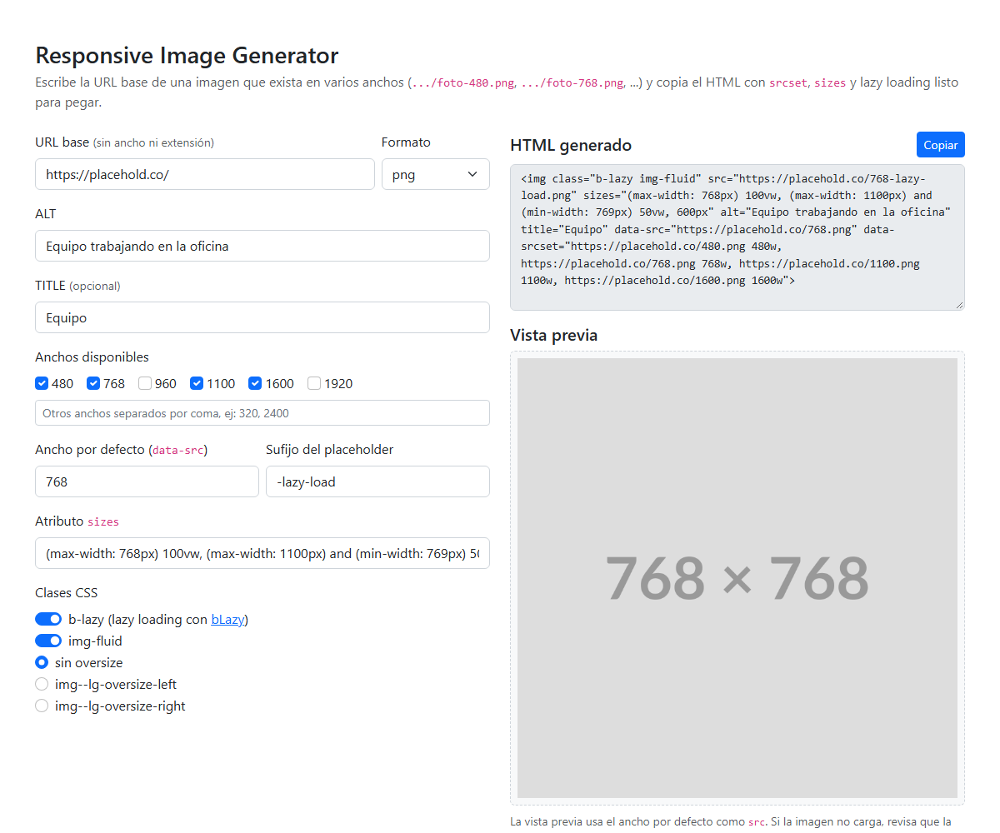

# Responsive Image Generator

**Demo en vivo: https://gusdv16.github.io/img_generator/**

Herramienta web de una sola página que genera el HTML de una imagen responsive (`srcset`, `sizes` y lazy loading) a partir de una URL base. Nació como utilidad interna para cargar imágenes en un sitio de marketing, donde pegar a mano seis anchos por imagen era lento y propenso a errores.



## Cómo se usa

1. Escribe la **URL base**, sin ancho ni extensión. Por ejemplo, si existen `https://example.com/img/hero-480.png`, `hero-768.png`, etc., la base es `https://example.com/img/hero-`.
2. Elige el formato, el texto ALT, y los anchos disponibles (o agrega anchos propios separados por coma).
3. El HTML se actualiza en vivo. Pulsa **Copiar** y pégalo en tu página.

Ejemplo de salida:

```html

```

## Opciones

- Ancho por defecto, sufijo del placeholder (`-lazy-load`) y atributo `sizes` editables.
- Con la clase `b-lazy` genera el marcado para [bLazy](https://github.com/dinbror/blazy) (`data-src` / `data-srcset`). Sin ella usa `src` y `srcset` normales.
- Clases opcionales: `img-fluid` (Bootstrap) y `img--lg-oversize-left/right`.
- Vista previa de la imagen resultante.

## Uso local

No tiene build ni dependencias que instalar: abre `index.html` en el navegador. Bootstrap se carga desde un CDN.

## Historial

Esta es una versión mejorada de un fork. Cambios respecto a la original:

- Se reescribió en JavaScript puro (se quitó jQuery) y el HTML se construye como texto, escapando los atributos, en lugar de mutar un `` en el DOM.
- Salida en vivo, botón de copiar con `navigator.clipboard` (antes `execCommand` con un input temporal) y vista previa.
- Anchos personalizados, formatos `webp` y `avif`, y opciones de lazy loading configurables.
- Sin la clase `b-lazy` ahora genera `src` y `srcset` estándar (antes la salida siempre usaba `data-src`), y no emite atributos vacíos.
- Sin referencias a la marca ni a los recursos de la empresa original.

## Licencia

MIT. Ver [LICENSE](LICENSE).
